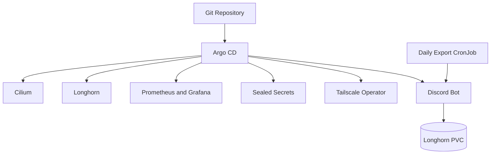

# Kubernetes GitOps Platform 

A GitOps-managed Kuberentes homelab running infrastructure services and some of my custom containerized workloads.

## Architecture 

### Deployment Flow

1. `apps/root` has a root application that ArgoCD uses for bootstrapping new applications. 
2. Infrastructure components are deployed via ArgoCD sync waves to prevent out-of-order resource deployment.
3. Helm charts consume values that are stored in this repository.
4. The Discord bot is deployed as an application workload. 
5. Tailscale provides private access to internal services.

--- 



--- 

## Repository Structure 

| Path                  | Purpose                                       |
| --------------------- | --------------------------------------------- |
| `apps/root`           | ArgoCD root application                       |
| `apps/infrastructure` | Cluster networking and storage                |
| `apps/platform`       | Shared platform services                      |
| `apps/workloads`      | Application-level ArgoCD definitions          |
| `manifests`           | Helm values and Kubernetes workload manifests |


## Deployed Components 

- __ArgoCD:__ GitOps reconciliation (self-managed from `manifests/argocd`)
- __Cilium:__ Container networking 
- __Longhorn:__ Persistent block storage 
- __Tailscale Operator:__ Private ingress/service access
- __Sealed Secrets:__ Encrypted, secure secret storage in Git 
- __kube-prometheus-stack:__ Metrics and dashboards 
- __Discord Bot:__ Application workload 
- __Disciord export CronJob:__ Scheduled batch processing

## Upgrading / Recovering ArgoCD

ArgoCD manages itself through `apps/platform/argocd.yaml`. To upgrade, bump the version tag in `manifests/argocd/kustomization.yaml` one minor release at a time, after reading the [upgrade notes](https://argo-cd.readthedocs.io/en/stable/operator-manual/upgrading/overview/).

If an upgrade leaves ArgoCD unable to sync itself, fix the tag and apply it by hand:

```sh
kubectl apply -k manifests/argocd --server-side --force-conflicts
```
